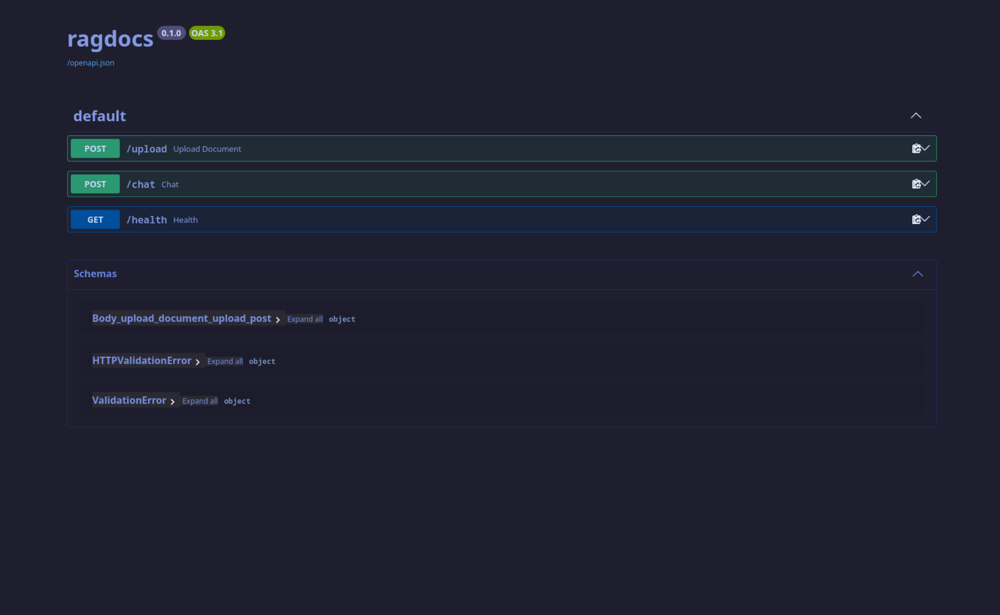
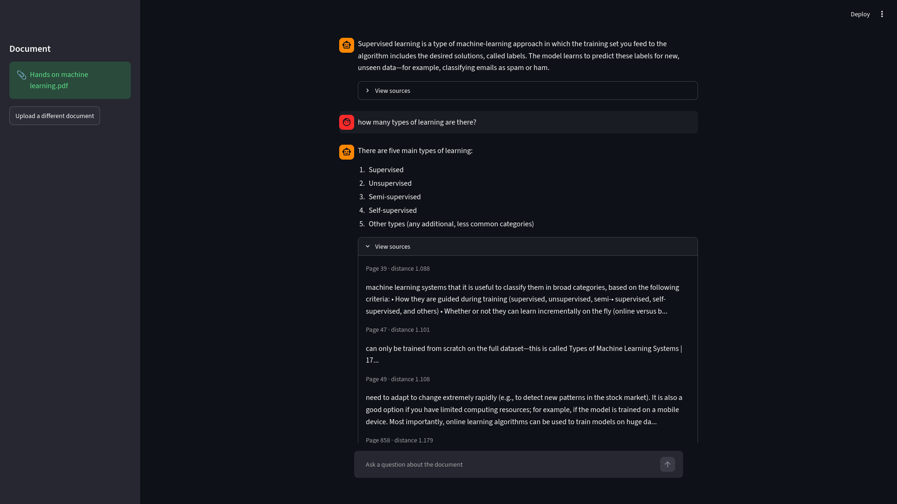

# ragdocs

[](https://github.com/maniesh-lab/ragdocs/actions/workflows/ci.yml)

**[Live Demo](https://ragdocs.streamlit.app/)**

A RAG (Retrieval-Augmented Generation) chatbot that answers questions about
any PDF you upload. It answers only from what's in the document, shows the page
each answer came from, and says "I don't know" when the answer isn't there,
instead of making something up.

You can use it through a Streamlit chat UI or a FastAPI API. The retrieval part
is written by hand (no LangChain): the PDF is split into overlapping chunks,
embedded locally with sentence-transformers, stored in Chroma, and the closest
chunks are sent to Gemini to write the answer. The code is split into `api`,
`services` and `core`, so each step lives in its own file.

---
## Features
- Upload any PDF and ask natural-language questions about its content
- Retrieval-augmented answers — the LLM only answers from chunks actually retrieved from the document, and says "I don't know" when the answer isn't present
- Every answer includes page-level source citations with a distance score for each chunk (lower = closer match)
- Per-document isolation — each upload gets its own vector collection, so multiple documents never bleed into each other's answers
- Local embeddings (`sentence-transformers`) — no API cost or external call for the retrieval step
- Free-tier LLM inference via Gemini — no paid API spend required to run or demo
- Input validation — rejects non-PDF uploads, oversized files (50 MB default, checked by both the API and the chat UI), corrupted PDFs, and unreadable (scanned/image-only) PDFs with clear error messages
- Safe file handling — uploads are saved under a generated ID, never the client's filename, so a crafted name can't write outside the uploads folder and same-named uploads can't overwrite each other
- Graceful failure handling — if a PDF can't be processed or the Gemini call fails, the chat UI shows an error message instead of crashing
- Interactive, self-documenting API via Swagger UI
- Streamlit chat interface that calls the RAG pipeline directly (no backend needed) and keeps the conversation for the current browser session (cleared on refresh)
- Evaluated on a hand-written test set scoring faithfulness, relevancy, and correctness (see Evaluation below)
---
## Project Structure
```
ragdocs/
│
├── app/
│   ├── __init__.py
│   ├── api/
│   │   ├── __init__.py
│   │   └── routes.py            # POST /upload, POST /chat
│   │
│   ├── core/
│   │   ├── __init__.py
│   │   └── config.py            # environment/settings (pydantic-settings)
│   │
│   ├── services/
│   │   ├── __init__.py
│   │   ├── ingestion.py         # PDF → text → overlapping chunks
│   │   ├── embeddings.py        # chunks → vectors (sentence-transformers)
│   │   ├── vectorstore.py       # Chroma storage + similarity search
│   │   └── llm.py               # prompt building + Gemini inference
│   │
│   └── main.py                  # FastAPI app, health check
│
├── ui/
│   └── streamlit_app.py         # chat interface
│
├── eval/
│   ├── test_set.json            # 30 hand-written Q&A pairs
│   ├── run_eval.py              # runs the test set through the real pipeline
│   ├── score_eval.py            # grades the saved answers with a Groq model
│   └── results/                 # raw_results.json, scores.json, scores_detail.json
│
├── tests/                       # pytest unit tests (no model or API key needed)
│   ├── conftest.py
│   ├── helpers.py
│   ├── test_api.py
│   └── test_ingestion.py
│
├── data/
│   ├── uploads/                 # uploaded PDFs (gitignored, .gitkeep only)
│   └── chroma_db/               # persisted vector store (gitignored, .gitkeep only)
│
├── screenshots/
│   ├── swagger-docs.png
│   └── chat-interface.png
│
├── .github/workflows/ci.yml     # lint + tests on every push
├── .env.example
├── .gitignore
├── pytest.ini
├── ruff.toml                    # lint rules
├── requirements.txt
├── requirements-test.txt        # what the tests need
├── LICENSE
└── README.md
```
---
## How It Works
1. **Ingestion** — the PDF is split page by page, then chunked into overlapping ~200-word segments so no sentence is lost at a chunk boundary
2. **Embedding** — each chunk is converted into a 384-dimensional vector locally via `sentence-transformers` (`all-MiniLM-L6-v2`) — no API call, runs on CPU
3. **Storage** — chunks and vectors are stored in a dedicated Chroma collection per document, keyed by a generated `document_id`
4. **Retrieval** — an incoming question is embedded the same way, and Chroma returns the 5 most semantically similar chunks
5. **Generation** — those chunks are inserted into a prompt instructing the LLM to answer *only* from that context, then sent to Gemini for a fast, grounded response
---
## How to Run
**1. Clone the repo**
```bash
git clone https://github.com/maniesh-lab/ragdocs
cd ragdocs
```
**2. Create and activate a virtual environment**
```bash
python -m venv venv
source venv/bin/activate
```
**3. Install dependencies**
```bash
pip install -r requirements.txt
```
**4. Set up environment variables**
```bash
cp .env.example .env
```
Add a free Gemini API key from [aistudio.google.com](https://aistudio.google.com) to `.env`.

**5. Start the chat UI**
```bash
streamlit run ui/streamlit_app.py
```
Visit `http://127.0.0.1:8501`. The chat UI runs the pipeline itself, so it doesn't need the backend.

**6. Start the API (optional)**
```bash
uvicorn app.main:app --reload
```
Only needed if you want to use the API directly. Visit `http://127.0.0.1:8000/docs` to try it in Swagger UI.

**Run the tests**
```bash
pip install -r requirements-test.txt
pytest
```
The tests cover chunking, upload checks (file type, size, broken or scanned PDFs,
unsafe file names) and the chat endpoint. They swap the embedding model, Chroma
and Gemini for stand-ins, so they run in seconds without an API key or the model
download. Answer *quality* is measured separately by the evaluation below.
GitHub Actions runs the tests, plus a `ruff` lint check, on Python 3.10–3.13 for
every push.
---
## API Docs

---
## Example Request
```bash
curl -X POST "http://127.0.0.1:8000/upload" \
  -H "accept: application/json" \
  -H "Content-Type: multipart/form-data" \
  -F "file=@your_document.pdf;type=application/pdf"
```
```bash
curl -X POST "http://127.0.0.1:8000/chat?question=what+is+gradient+descent&document_id=YOUR_DOCUMENT_ID" \
  -H "accept: application/json"
```
## Example Response
```json
{
  "answer": "Gradient descent is a generic optimization algorithm that iteratively adjusts a model's parameters to minimize a cost function...",
  "sources": [
    {
      "text": "Gradient descent is a generic optimization algorithm capable of finding optimal solutions...",
      "source": "your_document.pdf",
      "page": 172,
      "distance": 0.803
    }
  ]
}
```
`distance` measures how far the chunk is from the question in embedding
space — lower means a closer match.


---
## Evaluation
The pipeline was tested against a hand-written set of 30 question/reference-answer
pairs spanning the full range of a 500+ page ML textbook (basic concepts through
deep learning and modern LLM fine-tuning). Every answer was scored by an LLM judge
across three metrics:


| Metric | Score |
|---|---|
| Faithfulness (answer only claims what the retrieved context supports) | 0.94 |
| Relevancy (answer actually addresses the question) | 0.92 |
| Correctness (answer matches the reference answer's meaning) | 0.91 |


One question in the full set scored 0.0 across all three metrics — not because the
model hallucinated, but because retrieval surfaced topically-adjacent chunks that
never actually contained the answer, and the pipeline correctly responded "I don't
know" rather than guess. This is the intended safety behavior (see Known
Limitations below) showing up in practice, not a failure of the generation step.

Reproducing the eval requires uploading the same source PDF first, then passing
its `document_id` to the eval script:

```bash
python eval/run_eval.py <document_id>
python eval/score_eval.py   # needs GROQ_API_KEY in .env (the judge runs on Groq)
```

The committed results in `eval/results/` reflect the original test run.
---

## Tech Stack
| Tool | Purpose |
|---|---|
| `fastapi` | API framework |
| `chromadb` | Local vector database |
| `sentence-transformers` | Local text embeddings |
| `google-genai` | LLM inference via Gemini (free tier) |
| `streamlit` | Chat interface |
| `pypdf` | PDF text extraction |
| `pydantic-settings` | Configuration management |
| `pytest` | Unit tests |
| `ruff` | Lint check, run with the tests by GitHub Actions on every push |
---

## Use Case
Built for anyone who needs quick, grounded answers from a long document — a
manual, a textbook, a report — without manually searching through it page by
page. Upload once, ask as many questions as needed, get answers with sources
you can verify.

---
## Known Limitations
RAG retrieves a handful of relevant *chunks*, not the whole document at once.
This makes it strong at specific factual questions ("what is gradient
descent?") but structurally unable to answer whole-document questions like
"how many pages does this have?" or "which chapter is longest?" — no single
chunk contains that answer. The app is designed to say "I don't know" in these
cases rather than guess.

---
## Notes
- Non-PDF files and corrupted PDFs are rejected with a `400` error; files over the size limit get a `413`
- An unknown `document_id` on `/chat` returns a `404` without creating anything on disk
- Scanned/image-only PDFs (no extractable text) are rejected with a clear error message
- Each uploaded document is isolated in its own Chroma collection — multiple documents can be indexed without their content mixing in answers
- No LangChain — the chunking, embedding, and retrieval pipeline is hand-written for full understanding and control over each step
- `torchvision` is in `requirements.txt` only for hosting on Streamlit. The app never uses it, but Streamlit's file watcher looks inside every loaded module, and that makes transformers (which sentence-transformers uses) try to load an image module that needs torchvision. Without it, the app logs `No module named 'torchvision'`
---
## Author
**Manish Pandeya** · [github.com/maniesh-lab](https://github.com/maniesh-lab)